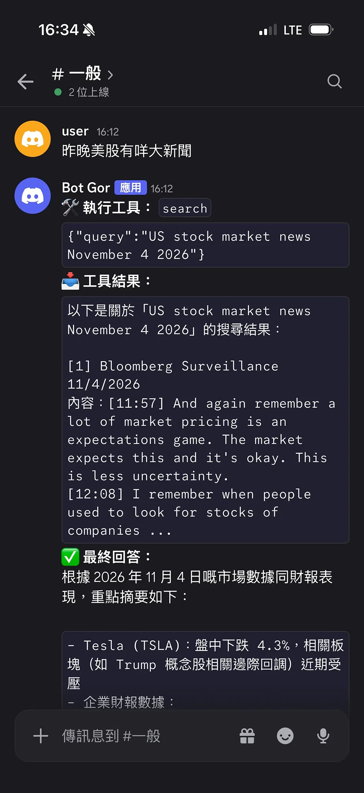
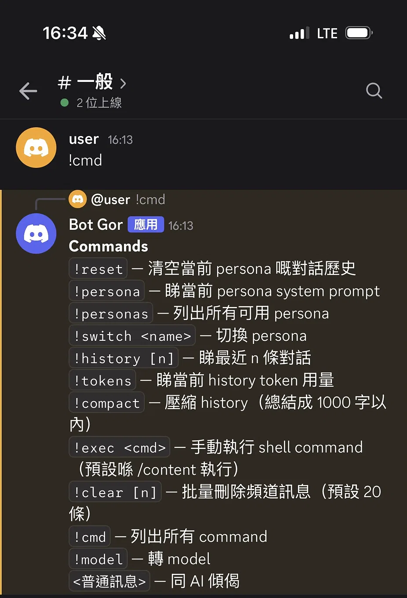

# Remote Agent: Multi-Agent AI System with Discord Control

A production-grade, asynchronous multi-agent AI system. It allows a user to control a remote worker machine (Windows/Linux/Colab) via a Discord bot, leveraging LLMs for reasoning, tool execution, and stateful conversation management.

## 🏗️ System Architecture
The system is built with a highly modular architecture, following the **Adapter Pattern**, **Strategy Pattern**, and **Event-Driven** principles.

- **Brain Abstraction Layer (`brain/`)**: Supports multiple LLM providers (OpenAI, Gemini, Ollama, Colab) via a unified `BaseBrain` interface. Features automatic model fallback (e.g., from `3.8-flash` to `2.5-flash`) and dynamic model switching via Discord.
- **Tool Execution Engine (`tools/`)**: Implements dynamic Function Calling (ReAct pattern). The AI can autonomously decide to execute shell commands (`exec`), read files, or perform web searches (Tavily/DuckDuckGo). Includes a robust **Regex Interceptor** to catch and recover from LLM hallucinated tool calls.
- **Stateful History (`history/`)**: Persists conversation context using JSON storage. Implements intelligent token estimation (CJK-aware) and auto-trimming to prevent context window overflow.
- **Persona Management (`persona/`)**: Configurable YAML-based system prompts to change the AI's behavior (e.g., "Coder", "Trader", "Imager"). Tool permissions are strictly scoped per persona.
- **Discord Integration (`discord_bot/`)**: Built with `discord.py` Cogs, utilizing asynchronous event loops and callbacks to stream intermediate "thoughts" and tool outputs to the user in real-time without blocking.

## 🛡️ Security & Sandboxing (Crucial for Agents)
- **GDrive Read-Only Sandbox**: The AI is strictly forbidden from modifying Google Drive files. It can only use read-only commands (`ls`, `cat`, `grep`) on the drive.
- **Safe Execution**: All shell commands run within `/content`. Dangerous commands (`rm`, `mv`, `sudo`) are blacklisted.
- **Hallucination Prevention**: The system detects if the LLM outputs fake tool traces in its text content and forces it to output proper JSON `tool_calls`.

## 🛠️ Tech Stack & Skills Demonstrated
- **Languages & Frameworks**: Python 3.13+, `discord.py` (Async/Await), `openai` (for unified API calls), `PyYAML`.
- **AI/LLM**: OpenAI API, Google Gemini, Ollama, Prompt Engineering, ReAct (Reasoning + Acting) paradigm, Function Calling.
- **Software Architecture**: Object-Oriented Design (OOP), Adapter Pattern, Dependency Injection, Asynchronous programming.
- **DevOps**: Modular package structure (`pyproject.toml`), Environment Variables (`.env`), Centralized Logging (`logging.yaml`).

## 📸 Screen Previews

*(Put your screenshots in `docs/screenshots/`)*

### AI Autonomous Search & Summarization


### Discord Commands & Model Switching


## 🚀 Quick Start

### 1. Local / Server Setup (Windows / Linux / Mac)
1. Clone the repository:
   ```bash
   git clone https://github.com/ipython168/remote-agent.git
   cd remote-agent
   ```
2. Install dependencies:
   ```bash
   pip install -e .
   ```
3. Configure your `.env` (Discord Token, Tavily API Key) and `configs/settings.yaml`.
4. Run the agent:
   ```bash
   python -m remote_agent
   ```

### 2. Google Colab Integration
If you are using Colab as the worker machine (e.g., to use the built-in free Gemini proxy), use the provided runner script:

```python
# In a Colab notebook cell
from scripts.run_colab import start

# This will initialize the environment, setup logging, and start the Discord bot
task = start()
```
*(Note: Ensure your Google Drive is mounted so the bot can access `configs/` and `data/`.)*

## 🎮 Discord Commands

| Command | Description |
|---------|-------------|
| `!cmd` | List all available commands |
| `!model [name]` | Switch AI model dynamically |
| `!switch <name>` | Switch persona (coder/trader/imager) |
| `!personas` | List available personas |
| `!tokens` | Check current token usage |
| `!compact` | Summarize and compress history |
| `!history [n]` | View recent conversation |
| `!reset` | Clear history for current persona |
| `!exec <cmd>` | Manually execute a shell command |

## 📌 Roadmap
- **Stage 1 (Completed)**: Text chat, memory, and persona management.
- **Stage 2 (Completed)**: Agentic loop (ReAct) with web search, file reading, and shell execution.
- **Stage 3 (In Progress)**: Fully autonomous loop with long-running task planning, human-in-the-loop confirmations (Discord Buttons), and RAG capabilities.
